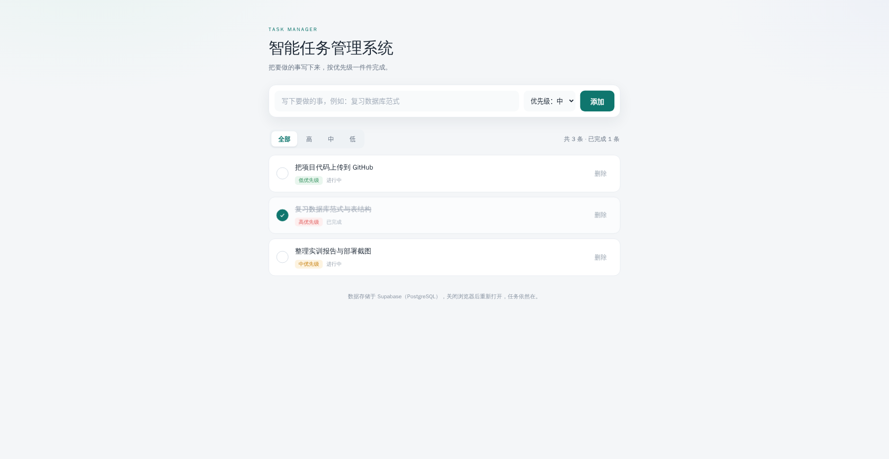
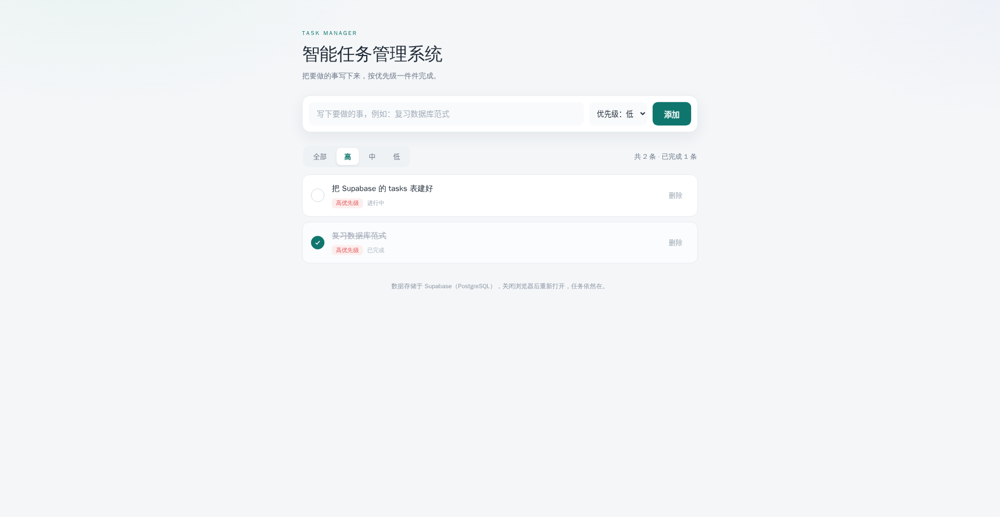

# 智能任务管理系统（练习二）

一个可直接运行、可直接部署的中文任务管理应用，按《智能任务管理系统-开发部署操作手册》的技术栈实现：

**Node.js 后端 + React 前端 + Supabase（PostgreSQL）数据库 + GitHub 托管 + Vercel 部署**

## 一、已实现的功能

- 输入框 + 优先级下拉（高 / 中 / 低）添加任务
- 任务列表按创建时间倒序显示（最新在最上面）
- 每条任务显示标题、优先级标签、完成状态
- 每条任务有两个按钮：切换完成 / 未完成、删除
- 已完成任务文字自动加删除线、颜色变淡
- 顶部可按优先级筛选：全部 / 高 / 中 / 低
- 数据存于 Supabase 云端数据库，关闭浏览器再打开数据仍在





## 二、技术栈与目录结构

```
task-manager/
├── api/                     # Vercel Serverless 函数（部署时由 Vercel 自动识别）
│   ├── tasks.js             # GET/POST  /api/tasks
│   └── tasks/[id].js        # PATCH/DELETE  /api/tasks/:id
├── server/                  # 后端核心逻辑（本地与云端共用同一份代码）
│   ├── supabase.js          # Supabase 客户端（读取环境变量）
│   ├── store.js             # 数据层：Supabase 优先，未配置时用本地文件预览
│   ├── tasks-service.js     # 业务校验：标题、优先级、完成状态
│   ├── router.js            # 本地 Express 路由
│   ├── http.js              # 请求体解析与统一错误响应
│   └── errors.js            # 带状态码的业务异常
├── client/                  # React 前端（Vite）
│   ├── index.html
│   └── src/
│       ├── App.jsx          # 页面与全部交互
│       ├── styles.css       # 样式
│       └── main.jsx         # 入口
├── scripts/
│   ├── dev-server.js        # 一条命令同时启动前后端（开发 / 生产）
│   └── check.js             # 全链路自检（查询→新增→切换→删除）
├── supabase/schema.sql      # 建表 + RLS 策略（在 Supabase SQL Editor 执行）
├── .env.example             # 环境变量模板
├── vercel.json              # Vercel 构建配置
└── package.json
```

## 三、本地运行（先跑起来，不碰数据库）

```bash
cd task-manager
npm install
npm run dev
```

打开 http://localhost:5173 即可看到页面。

> 这时还没配置 Supabase，程序会自动使用**本地文件预览模式**（数据存在 `data/tasks.json`），方便你先调界面和功能；配置 Supabase 后会自动切换成云端数据库，代码不用改。

## 四、接入自己的 Supabase（对应手册第四、五步）

### 4.1 新建项目

登录 https://supabase.com → New Project

| 项 | 填写 |
|---|---|
| Name | task-manager |
| Database Password | 设一个强密码并记下 |
| Region | Southeast Asia (Singapore) |

等 1～2 分钟状态变成 Active。

### 4.2 建表 + 开 RLS

左侧 **SQL Editor → New query**，把 `supabase/schema.sql` 整个文件粘进去，点 **Run**，看到 `Success. No rows returned` 即成功。

这个文件做了三件事：

1. 建 `tasks` 表（id 自增主键、title、priority 只能取 高/中/低、completed 默认 false、created_at 默认当前时间）
2. `alter table tasks enable row level security;`
3. 建四条匿名读写策略（教学演示用，正式项目要改成按登录用户隔离）

> 不执行第 3 步，写入会被拦下并报 `new row violates row-level security policy`。

### 4.3 填入连接凭据

左侧 **Project Settings（齿轮）→ API Keys**，复制：

- **Project URL**：`https://xxxx.supabase.co`
- **Publishable key**：`sb_publishable_...`（不要复制 `sb_secret_...`，那是保密密钥）

```bash
cp .env.example .env
```

打开 `.env` 填好这两行：

```
SUPABASE_URL=https://你的项目ID.supabase.co
SUPABASE_ANON_KEY=sb_publishable_你的key
```

### 4.4 自检（手册第五步要求的“每一步是否成功”）

```bash
npm run check
```

脚本会依次执行：查询列表 → 新增任务 → 切换为已完成 → 切换为未完成 → 删除测试数据，并逐项打印 `[通过]` / `[失败]`。全部通过说明表、RLS、URL、key 都没问题。

### 4.5 重启页面验证

```bash
npm run dev
```

浏览器加几条任务 → 切完成状态 → 删除 → 切筛选，再关掉浏览器重新打开，数据还在即全链路通了。

## 五、上传 GitHub（对应手册第六步）

1. GitHub → 右上角 `+` → New repository
2. Repository name：`task-manager`，选 **Public**，**不要**勾 Add a README file
3. 生成 PAT：Settings → Developer settings → Personal access tokens → Tokens (classic) → Generate new token，勾选 `repo` 权限，复制保存（只显示一次）
4. 在本项目目录执行：

```bash
git init
git add .
git commit -m "init: 智能任务管理系统"
git remote add origin https://github.com/你的用户名/task-manager.git
git branch -M main
git push -u origin main
```

推送时会要求输入账号和密码，**密码位置填 PAT**（GitHub 已不支持账号密码推送）。

> 项目里的 `.gitignore` 已经排除了 `.env`、`node_modules`、`data/`、`client/dist/`，`git status` 里看不到 `.env` 才安全。上传后到仓库页面确认一下 `.env` 没出现。

## 六、Vercel 部署（对应手册第七步）

1. 登录 https://vercel.com → Add New → Project
2. 选择 `task-manager` 仓库 → Import
3. Vercel 会自动识别 Vite 前端 + `api/` 目录下的 Serverless 函数，无需改构建配置（`vercel.json` 已写好构建命令与输出目录）
4. 在 **Environment Variables** 里逐条添加：

| Name | Value |
|---|---|
| `SUPABASE_URL` | `https://你的项目ID.supabase.co` |
| `SUPABASE_ANON_KEY` | `sb_publishable_你的key` |
| `NODE_ENV` | `production` |

> 变量名不要改成 SUPABASE_KEY 之类；代码里读的就是 `SUPABASE_URL` 和 `SUPABASE_ANON_KEY`，值可以是新版 `sb_publishable_...`，SDK 两种格式都认。

5. 点 **Deploy**，等 1～3 分钟，拿到 `https://task-manager-xxx.vercel.app`
6. 打开网址，加一条任务 → 回 Supabase Table Editor 看到这条数据 → 刷新页面数据仍在，即部署成功

改过环境变量后记得 **Redeploy** 一次才生效。

## 七、绑定域名（对应手册 7.4）

域名规则：**姓名的拼音 + 序号 + `.rangzijigenghao.online`**，例如 `zhangsan01.rangzijigenghao.online`。

1. Vercel 项目 → **Settings → Domains → Add**，输入你的域名
2. 按 Vercel 给出的提示，在域名解析后台添加两类记录：

| 类型 | 名称（Host） | 值（Value） | 作用 |
|---|---|---|---|
| TXT | `_vercel`（部分平台填完整域名） | Vercel 页面给出的 `vc-domain-verify=...` | 验证域名归属 |
| CNAME | 你的域名前缀（如 `zhangsan01`） | `cname.vercel-dns.com` | 把域名指向 Vercel |

> 具体值以 Vercel 的 Domains 页面显示为准，照抄即可。
3. DNS 生效后（通常几分钟到几小时），Vercel 会自动签发 HTTPS 证书，页面显示 Valid Configuration 即完成。

## 八、完整验证清单（对应手册第八节）

- [ ] 本地页面能添加、完成、删除、筛选任务
- [ ] Supabase 左侧 Table Editor 能看到 `tasks` 表，并能看到你加的数据
- [ ] `npm run check` 五项全部通过
- [ ] GitHub 仓库能看到完整代码
- [ ] `.env` 没有出现在 GitHub 仓库里
- [ ] Vercel 给的 `.vercel.app` 网址能正常打开
- [ ] 在 Vercel 网址上加一条任务，Supabase Table Editor 能看到这条新数据
- [ ] 关掉浏览器再打开 Vercel 网址，数据还在

## 九、接口与常见错误

| 方法 | 路径 | 作用 |
|---|---|---|
| GET | `/api/tasks?priority=高` | 查询列表（priority 可省略） |
| POST | `/api/tasks` | 新增，body：`{ "title": "...", "priority": "中" }` |
| PATCH | `/api/tasks/:id` | 切换状态，body：`{ "completed": true }` |
| DELETE | `/api/tasks/:id` | 删除 |
| GET | `/api/health` | 查看当前用的是 Supabase 还是本地预览 |

页面顶部出现红色错误条时，对照下面的提示处理：

| 提示 | 原因与解决 |
|---|---|
| 服务端未配置 Supabase | 本地 `.env` 或 Vercel 环境变量缺 `SUPABASE_URL` / `SUPABASE_ANON_KEY` |
| 数据表 tasks 不存在 | 没执行 `supabase/schema.sql` 的建表语句 |
| 写入被行级安全策略（RLS）拦截 | 没执行 schema.sql 里的四条 policy |
| 任务不存在或已被删除 | id 不对，或该条已被别人删掉 |

手册 FAQ 里另外三条也记一下：`git push` 提示 Permission denied 说明要用 PAT 而不是密码；Vercel 页面看不到数据先核对环境变量里的项目 ID 是否和 Supabase 后台一致；Supabase 提示旧 anon key 要弃用，换成 `sb_publishable_...` 即可，代码不用动。

## 十、拓展练习（手册第十一节，可在本工程基础上直接改）

1. 给 `tasks` 表加 `due_date date`，列表按是否逾期标红
2. 加搜索框：`/api/tasks?keyword=`，Supabase 侧用 `.ilike('title', '%关键词%')`
3. 加统计面板：总数、完成数、高优先级剩余数（前端已有 `tasks` 数组，直接算）
4. 接入 Supabase Auth，把 RLS 改成 `auth.uid() = user_id`，实现“登录用户只能看自己的任务”
5. 改一行代码 push 到 GitHub，观察 Vercel 自动重新部署
